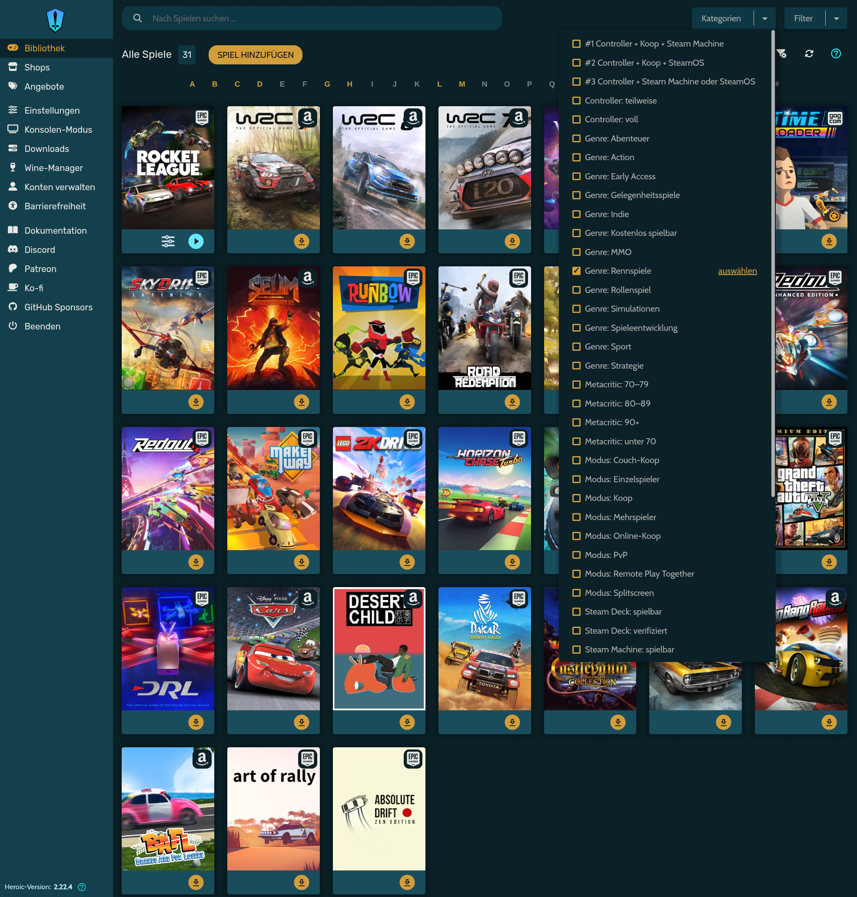
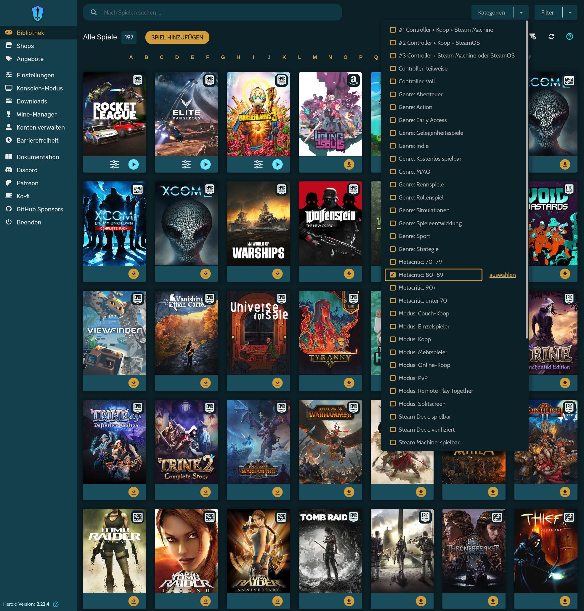
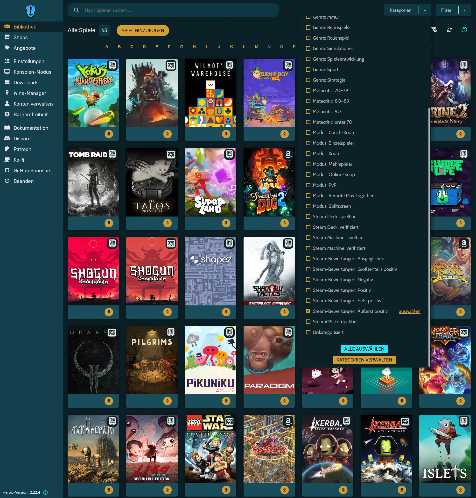
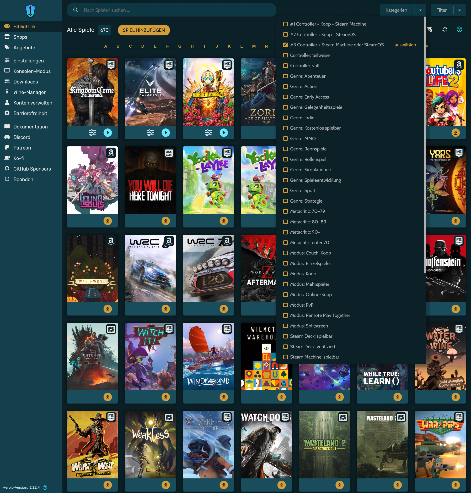

# 🏷️ heroic-autotag

<p align="center">
  
  
  
  
  
</p>

🇬🇧 [English](README.md) · 🇩🇪 **Deutsch**

Sortiert deine Bibliothek im [Heroic Games Launcher](https://heroicgameslauncher.com) automatisch in Kategorien ein: Controller-Unterstützung, Spielmodi (Koop, Splitscreen, …), Genres, Bewertungen (Metacritic, Steam) sowie Kompatibilität mit Steam Machine, Steam Deck und SteamOS.

📄 eine Python-Datei · 📦 nur Standardbibliothek · 🔑 kein Konto, kein API-Schlüssel · 🐧 nativ und Flatpak (SteamOS, Steam Machine, Steam Deck) · 🌍 fünf Sprachen

> [!TIP]
> **Alle Optionen mit Beispielen:** `python3 heroic_autotag.py --help` · **Klappt etwas nicht?** → [Hilfe bei Problemen](#-hilfe-bei-problemen)

### Was deine Spiele bekommen

| Spiel | 🎮 Controller | 👥 Modi | 🏷️ Genres | ⭐ Bewertungen | 🕹️ Steam Deck |
|---|---|---|---|---|---|
| Disco Elysium – The Final Cut | voll | Einzelspieler | Rollenspiel | Metacritic 90+ · Sehr positiv | verifiziert |
| LEGO Star Wars: Classic Obi-Wan | voll | Koop, Couch-Koop, Splitscreen, Remote Play Together | Action, Abenteuer | Metacritic 70–79 · Sehr positiv | verifiziert |
| Overcooked: Gourmet Edition | voll | Koop, Couch-Koop, Splitscreen, PvP | Action, Gelegenheitsspiele, Simulationen | Metacritic 80–89 | – |
| Akalabeth: World of Doom¹ | – | Einzelspieler | Rollenspiel | – | – |

<sub>¹ nicht auf Steam, Daten von PCGamingWiki. Echte Ergebnisse aus einer Bibliothek mit rund 1.100 Spielen.</sub>

Dazu kommen **Kombis** wie *#1 Controller + Koop + Steam Machine*, die ganz oben in Heroics Kategorienliste stehen.

## 📸 Screenshot

<p align="center">
  
  <br><sub>Heroics Kategorien-Filter mit den von heroic-autotag angelegten Kategorien, hier <i>Genre: Rennspiele</i></sub>
</p>

## ✨ Funktionen

- **Kategorien:** Controller-Unterstützung, Spielmodi, Genres, Kompatibilität mit Steam Machine, Steam Deck und SteamOS
- **Bewertungen:** Metacritic-Bereiche und Steam-Bewertungen als Kategorien, dazu eine Rangliste deiner am besten bewerteten Spiele (`--top`)
- **Kombis (UND):** z. B. *Controller UND Koop UND Steam Machine*, ganz oben in der Liste
- **Einstellungsdatei:** jede Kategorie ein- oder ausschalten und eigene Kombis festlegen, in `categories.ini`
- **Fünf Sprachen** für Kategorien und alle Ausgaben: Englisch, Deutsch, Spanisch, Italienisch, Französisch
- **Zwei Datenquellen:** zuerst Steam, für Spiele, die es dort nicht gibt, PCGamingWiki
- **Große Bibliotheken:** parallele Abfragen, Cache, jederzeit mit Strg+C unterbrechbar und fortsetzbar
- **Sicher:** sichert Heroics `config.json` vor jedem Schreiben und lässt deine eigenen Kategorien in Ruhe
- **Starter für den Spielmodus**, um das Skript auf Steam Machine oder Steam Deck per Controller auszuführen

## 📋 Voraussetzungen

- Heroic Games Launcher ab Version 2.11 (eigene Kategorien), nativ oder als Flatpak
- Python ab Version 3.8 (auf den meisten Linux-Distributionen und unter SteamOS vorinstalliert)
- Internetverbindung

## 📦 Installation

```bash
git clone https://github.com/Slashdacoda/heroic-autotag.git
cd heroic-autotag
```

Oder lade nur `heroic_autotag.py` herunter (und `steam-gamemode.sh` für den Spielmodus).

## 🚀 Schnellstart

1. Heroic komplett schließen, auch aus dem Tray.
2. Ausführen:
   ```bash
   python3 heroic_autotag.py
   ```
3. Heroic starten, in der Bibliothek den Kategorien-Filter öffnen und eine Kategorie wählen.

> [!TIP]
> `python3 heroic_autotag.py --help` zeigt alle Optionen mit kurzer Beschreibung und Beispielaufrufen, in deiner Sprache.

So sieht ein Lauf aus (gekürzt, hier mit 80 neuen Spielen):

```console
$ python3 heroic_autotag.py
Heroic (nativ): /home/user/.config/heroic
1168 Spiele in Heroic, 1088 davon schon im Cache.
80 Spiele werden abgefragt (4 Threads), geschätzt ca. 2 Minuten.
Abbrechen mit Strg+C ist jederzeit möglich, der Fortschritt bleibt erhalten.

[   1/80] Brothers: A Tale of Two Sons                            ok (Steam)
[   2/80] Moving Out                                              ok (Steam)
[   3/80] Akalabeth: World of Doom                                ok (PCGamingWiki)
[   4/80] Supraland                                               ok (Steam)
[   5/80] Vagrus - The Riven Realms: Prologue                     nicht gefunden
  …
[  79/80] Crossed Swords                                          ok (PCGamingWiki)
[  80/80] Blazing Sails                                           ok (Steam)
Steam-Bewertungen für 72 Spiele werden abgefragt …

Kombis:
  #1 Controller + Koop + Steam Machine           192 Spiele
  #2 Controller + Koop + SteamOS                 193 Spiele
  #3 Controller + Steam Machine oder SteamOS     677 Spiele

Kategorien:
  Controller: teilweise                          153 Spiele
  Controller: voll                               687 Spiele
  Genre: Action                                  552 Spiele
  Genre: Rollenspiel                             284 Spiele
  Metacritic: 80–89                              202 Spiele
  Metacritic: 90+                                 17 Spiele
  Modus: Couch-Koop                              118 Spiele
  Modus: Splitscreen                             182 Spiele
  Steam Deck: verifiziert                        422 Spiele
  Steam Machine: verifiziert                     515 Spiele
  Steam-Bewertungen: Äußerst positiv              63 Spiele
  SteamOS: kompatibel                            815 Spiele
  …
  (Quelle: Steam)                               1008
  (Quelle: PCGamingWiki)                          73
  (nirgends gefunden)                             54

Fertig! Sicherung: /home/user/.config/heroic/store/config.json.bak-20261112-031502
54 Spiele nirgends gefunden – Liste mit  --list-unknown
```

Der erste Lauf dauert etwa 1,5–2 Sekunden pro Spiel, weil Steam die Anzahl der Abfragen begrenzt. Danach kommt alles aus dem Cache, und ein Lauf dauert nur noch Sekunden.

**Tipp für große Bibliotheken:** Den langsamen Teil laufen lassen, während Heroic offen bleibt, und danach in Sekunden schreiben:

```bash
python3 heroic_autotag.py --collect     # Heroic darf offen bleiben
python3 heroic_autotag.py --write       # vorher Heroic schließen
```

## ⚙️ Bedienung

Alle Optionen mit kurzer Beschreibung und Beispielen, in deiner Sprache:

```bash
python3 heroic_autotag.py --help
```

**Was soll passieren** (ohne eine dieser Optionen: Daten sammeln und Kategorien schreiben)

| Option | Wirkung |
|---|---|
| `--collect` | nur Daten in den Cache holen (Heroic darf offen bleiben) |
| `--write` | nur Kategorien aus dem Cache schreiben (Heroic muss geschlossen sein) |
| `--test N\|TITEL …` | Spiele online testen, ohne etwas zu schreiben (siehe [Testen](#-testen)) |
| `--top N` | die N am besten bewerteten Spiele auflisten (Metacritic, dann Steam-Bewertung) |
| `--list-unknown` | nirgends gefundene Spiele auflisten |
| `--template` | nicht gefundene Spiele als Vorlage in die Datei für eigene Zuordnungen eintragen |
| `--init-config` | `categories.ini` mit allen Kategorien und den Standard-Kombis erzeugen |
| `-h`, `--help` | alle Optionen und Beispiele anzeigen |

**Abfragen**

| Option | Wirkung |
|---|---|
| `--max N` | höchstens N neue Spiele pro Lauf abfragen |
| `--threads N` | parallele Threads (Standard 4) |
| `--new` | Cache ignorieren und alles neu abfragen |
| `--retry-unknown` | nicht gefundene Spiele erneut suchen |
| `--refresh DAYS` | Cache-Einträge älter als DAYS Tage neu abfragen (Bewertungen ändern sich) |

**Kategorien und Ausgabe**

| Option | Wirkung |
|---|---|
| `--dry-run` | Ergebnis anzeigen, nichts schreiben |
| `--rule "…"` | mit `--top`: nur Spiele, die eine Regel erfüllen, z. B. `"mode.coop & controller.full"` |
| `-v`, `--verbose` | mit `--test`: zusätzlich die Rohdaten von Steam / PCGamingWiki zeigen |
| `--without GRUPPE …` | Gruppen weglassen: `controller`, `mode`, `genre`, `machine`, `deck`, `steamos`, `metacritic`, `reviews` |
| `--language en\|de\|es\|it\|fr` | Sprache der Kategorien und Ausgaben |

**Heroic und Einstellungen**

| Option | Wirkung |
|---|---|
| `--flatpak` / `--native` | Heroic-Installation erzwingen (wird normalerweise automatisch erkannt) |
| `--config DATEI` | andere Einstellungsdatei verwenden |
| `--force` | vorhandene `categories.ini` überschreiben (mit `--init-config`) |

## 💡 Beispiele

```bash
# normaler Lauf: Daten sammeln und Kategorien schreiben (vorher Heroic schließen)
python3 heroic_autotag.py

# ansehen, was passieren würde, nichts schreiben
python3 heroic_autotag.py --dry-run

# große Bibliothek: abfragen, während Heroic offen bleibt, dann in Sekunden schreiben
python3 heroic_autotag.py --collect
python3 heroic_autotag.py --write

# diesmal nur 50 neue Spiele abfragen
python3 heroic_autotag.py --collect --max 50

# die 20 am besten bewerteten Spiele, alle oder nur Koop-Spiele mit voller Controller-Unterstützung
python3 heroic_autotag.py --top 20
python3 heroic_autotag.py --top 20 --rule "mode.coop & controller.full"

# ohne Steam-Deck- und Genre-Kategorien, französische Namen
python3 heroic_autotag.py --without deck genre --language fr

# Cache-Einträge neu abfragen, die älter als 30 Tage sind (Bewertungen ändern sich)
python3 heroic_autotag.py --refresh 30
```

## 🧪 Testen

`--test` fragt Spiele online ab und zeigt, was das Skript daraus machen würde. Es **schreibt nichts**, weder in Heroics Konfiguration noch in den Cache. Heroic darf offen bleiben.

Du kannst eine **Anzahl**, einen **Namen** oder beides angeben:

```bash
python3 heroic_autotag.py --test 5                    # 5 zufällige Spiele aus deiner Bibliothek
python3 heroic_autotag.py --test "Celeste"            # ein Spiel per Name
python3 heroic_autotag.py --test witcher              # ein Namensteil reicht, wenn er in deiner Bibliothek eindeutig ist
python3 heroic_autotag.py --test 3 "Celeste" "Hades"  # 3 zufällige Spiele und zwei per Name
python3 heroic_autotag.py --test "Celeste" -v         # mit den Rohdaten von Steam / PCGamingWiki
```

Namen werden mit deiner Heroic-Bibliothek abgeglichen, Groß- und Kleinschreibung spielt keine Rolle. Passt ein Name auf mehrere Spiele, listet das Skript sie auf und testet den Namen wie eingegeben. Namen, die nicht in deiner Bibliothek stehen, werden ebenfalls wie eingegeben getestet.

Zu jedem Spiel siehst du die Suchvarianten, die Steam-AppID oder PCGamingWiki-Seite, die Bewertungen, die Kategorien und ob sie mit dem Cache übereinstimmen:

```
=== LEGO® Star Wars™: Classic Obi-Wan   (Heroic: legendary)
  Suchvarianten: ['LEGO® Star Wars™: Classic Obi-Wan', 'LEGO Star Wars: Classic Obi-Wan', 'LEGO Star Wars']
  Steam-AppID: 920210
  Gefunden: Steam
  Bewertungen: Metacritic 78 | Steam Sehr positiv (90%, 38,502)
  Ergebnis-Kategorien: Controller: voll, Genre: Abenteuer, Genre: Action, Metacritic: 70–79, Modus: Koop, …
  Cache: gleiche Kategorien

5 Spiele getestet: 4 gefunden, 1 nicht gefunden, 0 Netzfehler. Es wurde nichts geschrieben.
```

Wird ein Spiel falsch oder gar nicht gefunden, korrigierst du das in der [Datei für eigene Zuordnungen](#-nicht-gefundene-spiele).

Einen vollständigen Lauf erst an einem Teil der Bibliothek ausprobieren: `--max` und `--dry-run` kombinieren:

```bash
python3 heroic_autotag.py --max 20 --dry-run
```

Das holt bis zu 20 neue Spiele in den Cache und zeigt die Kategorien, ohne in Heroic zu schreiben.

## 🌍 Sprachen

Unterstützte Sprachen für Kategorien und alle Ausgaben:

| | Code | Sprache |
|---|---|---|
| 🇬🇧 | `en` | Englisch (Rückfall) |
| 🇩🇪 | `de` | Deutsch |
| 🇪🇸 | `es` | Spanisch |
| 🇮🇹 | `it` | Italienisch |
| 🇫🇷 | `fr` | Französisch |

Standardmäßig wird die Systemsprache verwendet. Alles außer den fünf unterstützten Sprachen fällt auf Englisch zurück. Mit `--language` legst du die Sprache fest:

```bash
python3 heroic_autotag.py --language fr
```

Beim Sprachwechsel werden die Kategorien in der bisherigen Sprache entfernt und in der neuen angelegt, damit nichts doppelt vorhanden ist.

## 🏷️ Kategorien

| Gruppe | Kategorien (Deutsch) |
|---|---|
| Controller | voll, teilweise |
| Modus | Einzelspieler, Mehrspieler, Koop, Online-Koop, Couch-Koop, Splitscreen, PvP, Remote Play Together |
| Genre | Action, Abenteuer, Rollenspiel, Strategie, Simulationen, Rennspiele, Sport, Gelegenheitsspiele, Indie, Kostenlos spielbar, MMO, Early Access |
| Steam Machine | verifiziert, spielbar |
| Steam Deck | verifiziert, spielbar |
| SteamOS | kompatibel |
| Metacritic | 90+, 80–89, 70–79, unter 70 |
| Steam-Bewertungen | Äußerst positiv, Sehr positiv, Positiv, Größtenteils positiv, Ausgeglichen, Negativ |

Eine Kategorie entsteht nur, wenn mindestens ein Spiel passt. Bei Genres müssen es mindestens zwei Spiele sein.

**Steam Machine:** Valve wertet Spiele mit „Steam Deck verifiziert“ automatisch auch als „Steam Machine verifiziert“. Das Skript übernimmt diese Regel, wenn Steam für ein Spiel noch keine eigene Steam-Machine-Bewertung hat.

**Hinweis:** Kategorien, deren Name mit diesen Präfixen (in einer der fünf Sprachen) oder mit dem Kombi-Präfix (`#1 …`) beginnt, verwaltet das Skript und baut sie bei jedem Lauf neu auf. Gib deinen eigenen Kategorien andere Namen.

## ⭐ Bewertungen

Heroic kann nur nach Titel sortieren. Die Bewertungen gibt es deshalb auf zwei Wegen:

**Als Kategorien** zum Filtern. Metacritic verwendet Bereiche statt Schwellen: Heroic verknüpft ausgewählte Kategorien mit ODER. Wählst du *90+* und *80–89*, bekommst du alle Spiele ab 80.

<table>
  <tr>
    <td></td>
    <td></td>
  </tr>
  <tr>
    <td align="center"><sub>Metacritic: 80–89</sub></td>
    <td align="center"><sub>Steam-Bewertungen: Äußerst positiv</sub></td>
  </tr>
</table>

**Als Rangliste** im Terminal, auf Wunsch mit einer Regel gefiltert (gleiche Schlüssel wie bei den Kombis unten):

```bash
python3 heroic_autotag.py --top 20
python3 heroic_autotag.py --top 20 --rule "mode.coop & controller.full"
```

```
   #  Metacritic             Steam  Titel
   1          93     96% (843,102)  The Witcher 3: Wild Hunt
   2          89     95% (221,111)  It Takes Two
   3          88     97% (134,389)  Celeste
```

**Woher die Daten kommen:**
- **Metacritic:** aus den Daten der Steam-Store-Seite, für Spiele, die es nicht auf Steam gibt, aus PCGamingWiki. Bei neuen Spielen keine zusätzliche Abfrage.
- **Steam-Bewertungen:** gebündelt, 50 Spiele pro Abfrage. Auch große Bibliotheken dauern nur Sekunden.

## 🧩 Einstellungsdatei und Kombis

Heroic verknüpft mehrere ausgewählte Kategorien mit ODER, die Liste wird also länger, je mehr du auswählst. Kombis lösen das: Das Skript berechnet UND-Regeln selbst und legt pro Regel eine eigene Kategorie an.

Einstellungsdatei einmalig erzeugen:

```bash
python3 heroic_autotag.py --init-config
```

Das schreibt `~/.config/heroic-autotag/categories.ini` mit Kommentaren in deiner Sprache. Ohne diese Datei gelten dieselben Standardwerte.

```ini
[general]
language = auto
genre_min_games = 2
combo_prefix = #{n}

[deck]
enabled = false          ; ganze Gruppe abschalten

[mode]
single = false           ; einzelne Kategorie abschalten

[combo:1]
enabled = true
rule = (controller.full | controller.partial) & (mode.splitscreen | mode.coop) & (machine.verified | machine.playable)
name.en = Controller + co-op + Steam Machine
name.de = Controller + Koop + Steam Machine
```

**Standard-Kombis:**

| # | Regel |
|---|---|
| 1 | Controller (voll oder teilweise) UND (Splitscreen oder Koop) UND Steam Machine (verifiziert oder spielbar) |
| 2 | Controller (voll oder teilweise) UND (Splitscreen oder Koop) UND SteamOS-kompatibel |
| 3 | Controller (voll oder teilweise) UND (SteamOS-kompatibel oder Steam Machine verifiziert/spielbar) |

<p align="center">
  
  <br><sub>Die Kombis stehen ganz oben in der Liste, hier <i>#3 Controller + Steam Machine oder SteamOS</i></sub>
</p>

**Regeln** verwenden die Schlüssel aus den Abschnitten in der Form `gruppe.schlüssel` (z. B. `controller.full`, `mode.coop`, `genre.rpg`, `machine.verified`, `steamos.compatible`, `metacritic.90`, `reviews.very_positive`):

| Operator | Bedeutung |
|---|---|
| `&` oder `and` | UND |
| `\|` oder `or` | ODER |
| `!` oder `not` | NICHT |
| `( )` | Klammern |

Eigene Kombis fügst du als `[combo:4]`, `[combo:5]` usw. hinzu. `name.xx` legt den Namen pro Sprache fest, ein einzelnes `name = …` gilt für alle Sprachen.

**Ganz oben:** Kombis bekommen das Präfix `#1`, `#2`, … Satzzeichen werden vor Buchstaben sortiert, und das Skript schreibt die Kombis zusätzlich als Erstes in Heroics Konfiguration. So stehen sie oben in der Kategorienliste. Das Präfix änderst du mit `combo_prefix` (`{n}` ist die Nummer).

Eine abgeschaltete Kategorie wird nur nicht angelegt. Kombis nutzen sie trotzdem: Du kannst zum Beispiel die ganze Gruppe „Steam Deck“ abschalten und `deck.verified` trotzdem in einer Regel verwenden.

## 🔍 Nicht gefundene Spiele

1. Mit verbesserter Suche und PCGamingWiki erneut versuchen:
   ```bash
   python3 heroic_autotag.py --retry-unknown
   ```
2. Für den Rest eine Vorlage anlegen:
   ```bash
   python3 heroic_autotag.py --template
   ```
   Das schreibt `~/.config/heroic-autotag/custom_mapping.txt`. Entferne die Raute `#` vor einer Zeile und trage entweder eine Steam-AppID bzw. einen Steam-Link oder direkt Kategorien ein:
   ```
   Ein Spiel = https://store.steampowered.com/app/123456/
   Anderes Spiel = Controller: voll, Genre: Rollenspiel
   ```

Alternativ kannst du solchen Spielen die Kategorien auch direkt in Heroic geben. Das Skript behält sie bei.

## 🎮 Steam Machine / Steam Deck (Spielmodus)

Die Flatpak-Version von Heroic wird automatisch erkannt. So startest du das Skript aus dem Spielmodus per Controller:

1. In den Desktop-Modus wechseln und das Repository klonen oder herunterladen, zum Beispiel nach `~/heroic-autotag`.
2. Den Starter ausführbar machen:
   ```bash
   chmod +x ~/heroic-autotag/steam-gamemode.sh
   ```
3. In Steam: **Spiele → Ein Nicht-Steam-Spiel zur Bibliothek hinzufügen → Durchsuchen**, als Dateityp *Alle Dateien* wählen und `steam-gamemode.sh` auswählen.
4. Optional: In den Eigenschaften der Verknüpfung einen Namen vergeben (z. B. „Heroic-Kategorien“) und Startoptionen wie `--language de` eintragen.
5. Zurück im Spielmodus die Verknüpfung starten. Ein Terminal im Vollbild zeigt den Fortschritt und schließt sich 20 Sekunden nach dem Ende selbst. Die Ausgabe wird zusätzlich in `~/.cache/heroic-autotag/last-run.log` gespeichert.

Heroic darf dabei nicht gleichzeitig laufen. Der erste Lauf dauert bei einer großen Bibliothek eine Weile. Du kannst ihn überspringen, indem du die Cache-Datei von einem anderen PC kopierst (siehe unten).

## 🔄 Aktualisieren

- **Neue Spiele:** Heroic einmal öffnen, damit es die Bibliothek aktualisiert, schließen und das Skript erneut ausführen. Es werden nur die neuen Spiele abgefragt.
- **Geänderte Bewertungen:** `--refresh 30` fragt Einträge, die älter als 30 Tage sind, neu ab.

## 📁 Dateien

| Datei | Zweck |
|---|---|
| `~/.config/heroic/store/config.json` | Heroics Konfiguration (nativ) |
| `~/.var/app/com.heroicgameslauncher.hgl/config/heroic/store/config.json` | Heroics Konfiguration (Flatpak) |
| `config.json.bak-DATUM-ZEIT` | Sicherung vor jedem Schreiben, neben der `config.json` |
| `~/.cache/heroic-autotag/cache.json` | Cache, nach Spieltitel gespeichert, auf andere Geräte kopierbar |
| `~/.config/heroic-autotag/categories.ini` | Einstellungen: Kategorien an/aus, Kombis |
| `~/.config/heroic-autotag/custom_mapping.txt` | deine eigenen Zuordnungen |
| `~/.cache/heroic-autotag/state.json` | merkt sich die Namen der Kombis, damit umbenannte Kombis aufgeräumt werden |

**Rückgängig machen:** Heroic schließen und eine Sicherung über die `config.json` kopieren.

## 🔧 Hilfe bei Problemen

Erste Schritte bei fast jedem Problem:

```bash
python3 heroic_autotag.py --help               # alle Optionen
python3 heroic_autotag.py --dry-run            # was geschrieben würde, ohne zu schreiben
python3 heroic_autotag.py --test "Titel" -v    # was Steam / PCGamingWiki zu einem Spiel liefern
```

<details>
<summary><b>„Keine Heroic-Installation gefunden“</b></summary>

Das Skript sucht `~/.config/heroic` (nativ) und `~/.var/app/com.heroicgameslauncher.hgl` (Flatpak). Heroic einmal starten, in den Stores anmelden und die Bibliothek laden lassen. Gibt es beide Installationen, nimmt das Skript die zuletzt benutzte; mit `--native` oder `--flatpak` legst du sie fest.
</details>

<details>
<summary><b>„Keine Spiele gefunden“</b></summary>

Heroic hat seine Bibliothek noch nicht gespeichert. Heroic öffnen, warten, bis alle Stores geladen sind, schließen und das Skript erneut starten.
</details>

<details>
<summary><b>„Heroic läuft noch“</b></summary>

Heroic überschreibt beim Beenden seine Konfiguration, deshalb schreibt das Skript nur bei geschlossenem Heroic. Heroic komplett beenden, auch das Tray-Symbol. Bei der Flatpak-Version:

```bash
flatpak kill com.heroicgameslauncher.hgl
```

Auf den langsamen Teil musst du nicht warten: `--collect` läuft bei offenem Heroic, `--write` dauert danach nur Sekunden.
</details>

<details>
<summary><b>Die Kategorien erscheinen nicht in Heroic</b></summary>

- Endete der Lauf mit „Fertig! Sicherung: …“? Mit `--dry-run` oder `--collect` wird nichts geschrieben.
- Heroic neu starten, es liest die Kategorien nur beim Start.
- Heroics **Konsolenmodus** zeigt eigene Kategorien derzeit nicht an. Die normale Oberfläche verwenden.
- Eine Kategorie entsteht nur, wenn mindestens ein Spiel passt (Genres: mindestens zwei, siehe `genre_min_games`).
</details>

<details>
<summary><b>Ein Spiel steht in falschen Kategorien oder wird nicht gefunden</b></summary>

1. Prüfen, was das Skript findet: `python3 heroic_autotag.py --test "Titel" -v`
2. Wurde das falsche oder gar kein Steam-Spiel gefunden, das richtige in die [Datei für eigene Zuordnungen](#-nicht-gefundene-spiele) eintragen, z. B. `Titel = https://store.steampowered.com/app/123456/`
3. Das Skript erneut starten. Bisher nicht gefundene Spiele sucht `--retry-unknown` noch einmal.
</details>

<details>
<summary><b>„Drosselung … alle Threads warten“</b> oder Netzfehler</summary>

Steam begrenzt die Zahl der Abfragen. Das Skript wartet automatisch und macht weiter, es geht nichts verloren. Passiert das oft, weniger Threads verwenden: `--threads 2`. Spiele mit Netzfehler werden beim nächsten Lauf erneut abgefragt.
</details>

<details>
<summary><b>Bei manchen Spielen fehlen Bewertungen</b></summary>

- **Metacritic-Werte** gibt es nur für Spiele, die Steam oder PCGamingWiki mit Wertung führen, vor allem größere Titel.
- **Steam-Bewertungen** brauchen einen Steam-Treffer und eine Mindestzahl an Rezensionen. Spiele, die nur auf PCGamingWiki gefunden werden, bekommen keine.
- Bewertungen ändern sich: `--refresh 30` fragt Einträge, die älter als 30 Tage sind, neu ab.
</details>

<details>
<summary><b>„Fehler in categories.ini“</b></summary>

Die Meldung nennt Abschnitt und Problem, z. B. einen unbekannten Schlüssel in einer Regel (`[combo:4] unbekannter Kategorie-Schlüssel 'mode.koop'`). Die Schlüssel stehen in der Datei selbst. Mit den Standardwerten neu anfangen:

```bash
python3 heroic_autotag.py --init-config --force
```
</details>

<details>
<summary><b>Falsche Sprache</b></summary>

Die Sprache richtet sich nach der Systemsprache. Mit `--language de` oder dauerhaft mit `language = de` in der `categories.ini` legst du sie fest. Beim Wechsel werden die Kategorien der alten Sprache ersetzt.
</details>

<details>
<summary><b>Meine eigene Kategorie wurde verändert</b></summary>

Namen, die mit einem Präfix des Skripts beginnen (`Controller: `, `Modus: `, `Genre: `, `Metacritic: `, … in einer der fünf Sprachen) oder mit dem Kombi-Präfix (`#1 …`), gehören dem Skript und werden bei jedem Lauf neu aufgebaut. Gib deiner Kategorie einen anderen Namen, z. B. `Meine Koop-Spiele`, und hol sie aus einer Sicherung zurück (siehe unten).
</details>

<details>
<summary><b>Rückgängig machen oder neu anfangen</b></summary>

- **Einen Lauf rückgängig machen:** Heroic schließen und eine Sicherung `config.json.bak-DATUM-ZEIT` über die `config.json` kopieren (beide im Ordner `store` von Heroic, siehe [Dateien](#-dateien)).
- **Alles neu abfragen:** `python3 heroic_autotag.py --new`
</details>

<details>
<summary><b>Spielmodus: Das Fenster schließt sich zu schnell</b></summary>

Die Ausgabe des letzten Laufs steht in `~/.cache/heroic-autotag/last-run.log`. Das Fenster bleibt 20 Sekunden offen; das änderst du mit der Startoption `WAIT=60 %command%` in den Eigenschaften der Verknüpfung.
</details>

## ⚠️ Einschränkungen

- **Heroics Konsolenmodus** filtert derzeit nur nach Store und zeigt keine eigenen Kategorien an. In der normalen Heroic-Oberfläche sind die Kategorien sichtbar.
- **Steam-Sammlungen** im Spielmodus von SteamOS sind unabhängig von Heroics Kategorien und werden nicht verändert.
- **SteamOS-Kompatibilität** wird aus einem nicht dokumentierten Steam-Feld gelesen und kann leer bleiben.
- Spiele aus **PCGamingWiki** bekommen keine Bewertung für Steam Machine, Steam Deck oder SteamOS und keine Steam-Bewertung, weil nur Steam diese liefert.
- **Metacritic-Werte** gibt es nur für Spiele, die Steam oder PCGamingWiki mit Wertung führen, vor allem größere Titel.
- Heroic selbst kann nicht nach Bewertung **sortieren**. Zum Filtern dienen die Kategorien, für eine Rangliste `--top`.
- Die Steam-Store-Schnittstellen sind keine offizielle API und können sich ändern.

## 🌐 Datenquellen

- Steam-Store (öffentliche Store-Schnittstellen)
- [PCGamingWiki](https://www.pcgamingwiki.com)

Dieses Projekt steht in keiner Verbindung zu Valve, Heroic Games Launcher, Epic Games, GOG, Amazon oder PCGamingWiki.

## 📄 Lizenz

[MIT](LICENSE): Du darfst das Projekt frei nutzen, verändern, forken und weitergeben, solange der Copyright-Hinweis erhalten bleibt.
