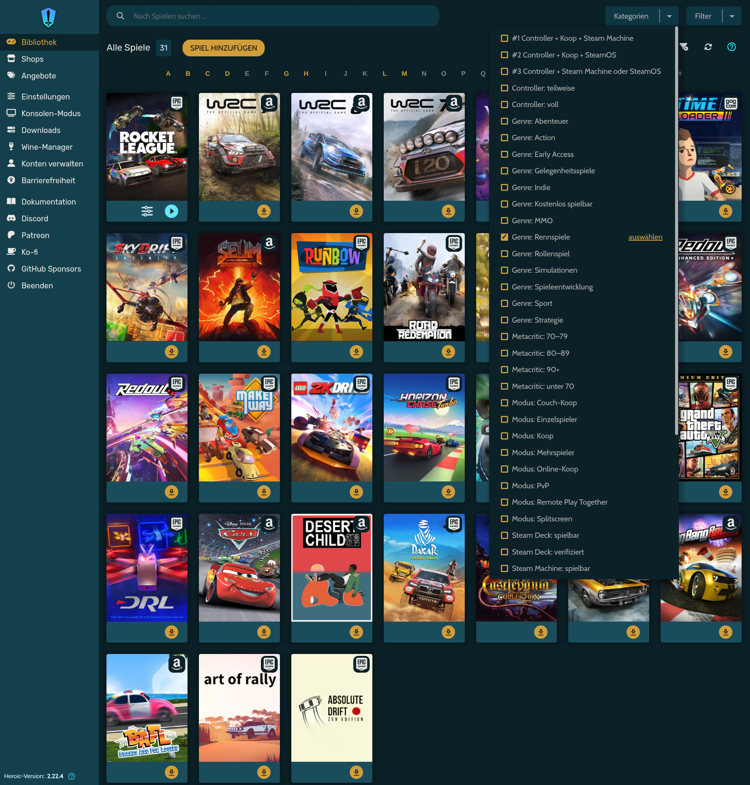
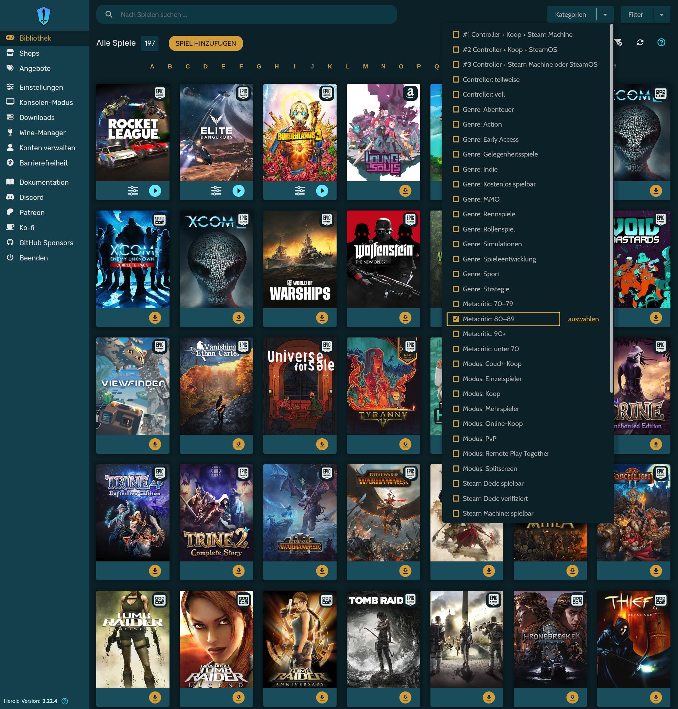
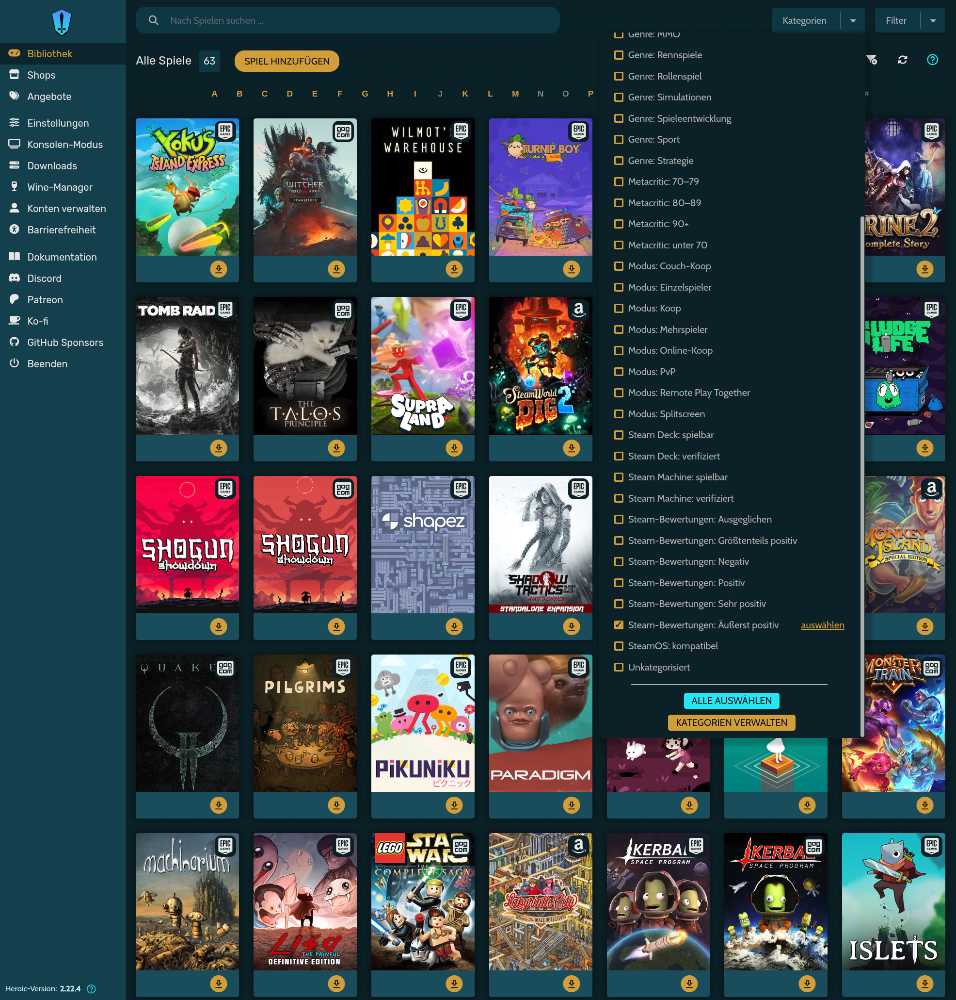
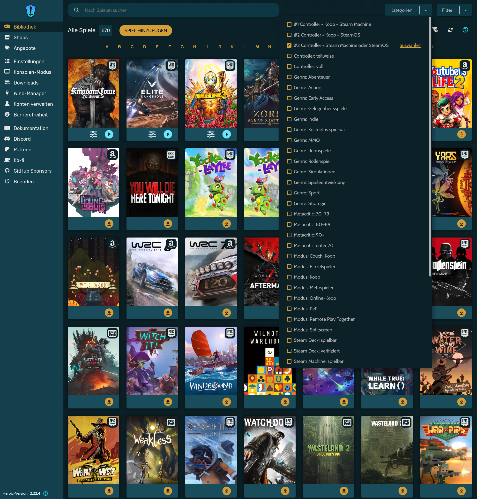

# 🏷️ heroic-autotag

<p align="center">
  
  
  
  
  
</p>

🇬🇧 **English** · 🇩🇪 [Deutsch](README.de.md)

Automatically sorts your [Heroic Games Launcher](https://heroicgameslauncher.com) library into categories: controller support, game modes (co-op, split screen, …), genres, ratings (Metacritic, Steam reviews) and Steam Machine / Steam Deck / SteamOS compatibility.

One Python file, standard library only. No account, no API key. Works with the native Heroic installation and with the Flatpak version (SteamOS, Steam Machine, Steam Deck).

```
[  12/50] Celeste                                    ok (Steam)
[  13/50] Akalabeth: World of Doom                   ok (PCGamingWiki)

Categories:
  Controller: full                     117 games
  Mode: Couch co-op                     15 games
  Steam Machine: verified               87 games
  ...
```

## 📸 Screenshot

<p align="center">
  
  <br><sub>Heroic's category filter with the categories created by heroic-autotag, here <i>Genre: Racing</i> (German language)</sub>
</p>

## ✨ Features

- **Categories:** controller support, game modes, genres, Steam Machine / Steam Deck / SteamOS compatibility
- **Ratings:** Metacritic score ranges and Steam review labels as categories, plus a ranked list of your best-rated games (`--top`)
- **Combinations (AND):** e.g. *controller AND co-op AND Steam Machine*, shown at the top of the list
- **Settings file:** switch every category on or off and define your own combinations in `categories.ini`
- **Five languages** for categories and all output: English, German, Spanish, Italian, French
- **Two data sources:** Steam first, PCGamingWiki for games that are not on Steam
- **Large libraries:** parallel requests, a cache, resumable at any time with Ctrl+C
- **Safe:** backs up Heroic's `config.json` before every write, never touches your own categories
- **Game Mode launcher** for running it with a controller on a Steam Machine or Steam Deck

## 📋 Requirements

- Heroic Games Launcher 2.11 or newer (custom categories), native or Flatpak
- Python 3.8 or newer (preinstalled on most Linux distributions and on SteamOS)
- Internet access

## 📦 Installation

```bash
git clone https://github.com/Slashdacoda/heroic-autotag.git
cd heroic-autotag
```

Or download `heroic_autotag.py` (and `steam-gamemode.sh` for Game Mode) on its own.

## 🚀 Quick start

1. Close Heroic completely (including the tray icon).
2. Run:
   ```bash
   python3 heroic_autotag.py
   ```
3. Start Heroic, open the category filter in the library and pick a category.

The first run takes about 1.5–2 seconds per game, because Steam limits how fast it may be queried. After that, everything comes from the cache and a run takes seconds.

**Tip for large libraries:** let the slow part run while Heroic stays open, then write in seconds:

```bash
python3 heroic_autotag.py --collect     # Heroic may stay open
python3 heroic_autotag.py --write       # close Heroic first
```

## ⚙️ Usage

| Option | What it does |
|---|---|
| *(none)* | collect data and write categories |
| `--collect` | only fetch data into the cache (Heroic may stay open) |
| `--write` | only write categories from the cache (Heroic must be closed) |
| `--dry-run` | show the result, write nothing |
| `--max N` | fetch at most N new games per run |
| `--threads N` | parallel threads (default 4) |
| `--language en\|de\|es\|it\|fr` | language of categories and output |
| `--without GROUP …` | skip groups: `controller`, `mode`, `genre`, `machine`, `deck`, `steamos`, `metacritic`, `reviews` |
| `--refresh DAYS` | fetch cache entries older than DAYS again (ratings change over time) |
| `--top N` | list the N best-rated games (Metacritic, then Steam reviews) |
| `--rule "…"` | with `--top`: only games matching a rule, e.g. `"mode.coop & controller.full"` |
| `--backfill-ratings` | fetch missing Metacritic scores for games already in the cache |
| `--retry-unknown` | search games that were not found again |
| `--list-unknown` | list games that were not found anywhere |
| `--template` | add unknown games to the custom mapping file as a template |
| `--test "Title"` | show what Steam and PCGamingWiki return for one title |
| `--init-config` | create `categories.ini` with all categories and the default combinations |
| `--force` | overwrite an existing `categories.ini` (with `--init-config`) |
| `--config FILE` | use another settings file |
| `--flatpak` / `--native` | force a Heroic installation (normally detected automatically) |
| `--new` | ignore the cache and fetch everything again |

The German option names of earlier versions (`--sammeln`, `--schreiben`, `--ohne`, …) still work.

## 🌍 Languages

Supported languages for categories and all output:

| | Code | Language |
|---|---|---|
| 🇬🇧 | `en` | English (fallback) |
| 🇩🇪 | `de` | German |
| 🇪🇸 | `es` | Spanish |
| 🇮🇹 | `it` | Italian |
| 🇫🇷 | `fr` | French |

By default the language is taken from your system language; anything other than the five supported languages falls back to English. Override it with `--language`:

```bash
python3 heroic_autotag.py --language fr
```

When you switch languages, the categories in the previous language are removed and recreated in the new one, so nothing is duplicated.

## 🏷️ Categories

| Group | Categories (English) |
|---|---|
| Controller | full, partial |
| Mode | Single-player, Multiplayer, Co-op, Online co-op, Couch co-op, Split screen, PvP, Remote Play Together |
| Genre | Action, Adventure, RPG, Strategy, Simulation, Racing, Sports, Casual, Indie, Free to Play, Massively Multiplayer, Early Access |
| Steam Machine | verified, playable |
| Steam Deck | verified, playable |
| SteamOS | compatible |
| Metacritic | 90+, 80–89, 70–79, under 70 |
| Steam reviews | Overwhelmingly Positive, Very Positive, Positive, Mostly Positive, Mixed, Negative |

A category is only created if at least one game matches; genres need at least two games.

**Steam Machine:** Valve counts games that are Steam Deck Verified as Steam Machine Verified as well. The script follows this rule when Steam has no separate Steam Machine rating for a game.

**Note:** category names starting with these prefixes (in any of the five languages) and with the combination prefix (`#1 …`) are managed by the script and rebuilt on every run. Give your own categories different names.

## ⭐ Ratings

Heroic can only sort by title, so the ratings are offered in two ways:

**As categories** for filtering. Metacritic uses ranges instead of thresholds: Heroic combines selected categories with OR, so selecting *90+* and *80–89* gives you every game rated 80 or better.

<table>
  <tr>
    <td></td>
    <td></td>
  </tr>
  <tr>
    <td align="center"><sub>Metacritic: 80–89</sub></td>
    <td align="center"><sub>Steam reviews: Overwhelmingly Positive</sub></td>
  </tr>
</table>

**As a ranked list** in the terminal, optionally filtered with a rule (same keys as the combinations below):

```bash
python3 heroic_autotag.py --top 20
python3 heroic_autotag.py --top 20 --rule "mode.coop & controller.full"
```

```
   #  Metacritic             Steam  Title
   1          93     96% (843,102)  The Witcher 3: Wild Hunt
   2          89     95% (221,111)  It Takes Two
   3          88     97% (134,389)  Celeste
```

**Where the data comes from:**
- **Metacritic:** from the Steam store page data, or from PCGamingWiki for games that are not on Steam. No extra requests for new games.
- **Steam reviews:** fetched in batches of 50 games per request, so even large libraries take only seconds.

**Cache from an older version?** Steam reviews are added automatically on the next run. Metacritic scores need one request per game, so they are only fetched on request:

```bash
python3 heroic_autotag.py --backfill-ratings
```

## 🧩 Settings file and combinations

Heroic combines several selected categories with OR, so the list grows the more you select. Combinations solve this: the script computes AND rules itself and creates one category per rule.

Create the settings file once:

```bash
python3 heroic_autotag.py --init-config
```

This writes `~/.config/heroic-autotag/categories.ini` with comments in your language. Without this file, the same defaults apply.

```ini
[general]
language = auto
genre_min_games = 2
combo_prefix = #{n}

[deck]
enabled = false          ; switch off the whole group

[mode]
single = false           ; switch off one category

[combo:1]
enabled = true
rule = (controller.full | controller.partial) & (mode.splitscreen | mode.coop) & (machine.verified | machine.playable)
name.en = Controller + co-op + Steam Machine
name.de = Controller + Koop + Steam Machine
```

**Default combinations:**

| # | Rule |
|---|---|
| 1 | controller (full or partial) AND (split screen or co-op) AND Steam Machine (verified or playable) |
| 2 | controller (full or partial) AND (split screen or co-op) AND SteamOS compatible |
| 3 | controller (full or partial) AND (SteamOS compatible or Steam Machine verified/playable) |

<p align="center">
  
  <br><sub>The combinations appear at the top of the list, here <i>#3 Controller + Steam Machine or SteamOS</i> (German language)</sub>
</p>

**Rules** use the keys from the sections, written as `group.key` (e.g. `controller.full`, `mode.coop`, `genre.rpg`, `machine.verified`, `steamos.compatible`, `metacritic.90`, `reviews.very_positive`):

| Operator | Meaning |
|---|---|
| `&` or `and` | AND |
| `\|` or `or` | OR |
| `!` or `not` | NOT |
| `( )` | grouping |

Add your own combinations as `[combo:4]`, `[combo:5]`, and so on. `name.xx` sets the name per language; a single `name = …` works for all languages.

**At the top:** combinations get the prefix `#1`, `#2`, … Punctuation sorts before letters, and the script also writes combinations first into Heroic's configuration, so they appear at the top of the category list. Change the prefix with `combo_prefix` (`{n}` is the number).

Switching a category off only hides it. Combinations still use it, so you can, for example, switch off the whole Steam Deck group and still use `deck.verified` in a rule.

## 🔍 Games that are not found

1. Try again with improved search and PCGamingWiki:
   ```bash
   python3 heroic_autotag.py --retry-unknown
   ```
2. For what is left, create a template:
   ```bash
   python3 heroic_autotag.py --template
   ```
   This writes `~/.config/heroic-autotag/custom_mapping.txt`. Remove the `#` in front of a line and add either a Steam AppID / Steam link, or categories directly:
   ```
   Some Game = https://store.steampowered.com/app/123456/
   Other Game = Controller: full, Genre: RPG
   ```

Alternatively, simply assign categories to such games in Heroic itself. The script keeps them.

## 🎮 Steam Machine / Steam Deck (Game Mode)

The Heroic Flatpak is detected automatically. To run the script from Game Mode with a controller:

1. Switch to Desktop Mode and clone or download the repository, e.g. to `~/heroic-autotag`.
2. Make the launcher executable:
   ```bash
   chmod +x ~/heroic-autotag/steam-gamemode.sh
   ```
3. In Steam: **Games → Add a Non-Steam Game to My Library → Browse**, set the file type to *All files* and select `steam-gamemode.sh`.
4. Optional: in the shortcut's properties, rename it (e.g. "Heroic Autotag") and add launch options such as `--language de`.
5. Back in Game Mode, start the shortcut. A full-screen terminal shows the progress and closes itself 20 seconds after it finishes. The output is also saved to `~/.cache/heroic-autotag/last-run.log`.

Heroic must not be running at the same time. The first run on a large library takes a while; you can copy the cache file from another PC to skip it (see below).

## 🔄 Updating

- **New games:** open Heroic once so it refreshes its library, close it, then run the script again. Only new games are fetched.
- **Changed ratings:** `--refresh 30` fetches entries older than 30 days again.

## 📁 Files

| File | Purpose |
|---|---|
| `~/.config/heroic/store/config.json` | Heroic's configuration (native) |
| `~/.var/app/com.heroicgameslauncher.hgl/config/heroic/store/config.json` | Heroic's configuration (Flatpak) |
| `config.json.bak-DATE-TIME` | backup created before every write, next to `config.json` |
| `~/.cache/heroic-autotag/cache.json` | cache, keyed by game title, can be copied to other devices |
| `~/.config/heroic-autotag/categories.ini` | settings: categories on/off, combinations |
| `~/.config/heroic-autotag/custom_mapping.txt` | your custom mappings |
| `~/.cache/heroic-autotag/state.json` | remembers the combination names, so renamed combinations are cleaned up |

**Undo:** close Heroic and copy a backup over `config.json`.

**Coming from an older version** (`heroic_kategorien.py`)? The folders `~/.config/heroic-kategorien` and `~/.cache/heroic-kategorien` are moved to the new names automatically on the first run, so your cache and settings are kept.

## ⚠️ Limitations

- **Heroic's Console Mode** currently only filters by store and does not show custom categories. The categories are visible in the normal Heroic interface.
- **Steam collections** in SteamOS Game Mode are separate from Heroic's categories and are not changed.
- **SteamOS compatibility** is read from an undocumented Steam field and may stay empty.
- Games from **PCGamingWiki** get no Steam Machine / Steam Deck / SteamOS ratings and no Steam reviews, since only Steam provides them.
- **Metacritic** scores exist only for games that Steam or PCGamingWiki list with a score, mostly larger titles.
- Heroic itself cannot **sort** by rating; use the categories to filter or `--top` for a ranked list.
- Steam's store endpoints are not an official API and may change.

## 🌐 Data sources

- Steam store (public store endpoints)
- [PCGamingWiki](https://www.pcgamingwiki.com)

This project is not affiliated with Valve, Heroic Games Launcher, Epic Games, GOG, Amazon or PCGamingWiki.

## 📄 License

[MIT](LICENSE): you may use, change, fork and share this project freely, as long as the copyright notice stays in it.
